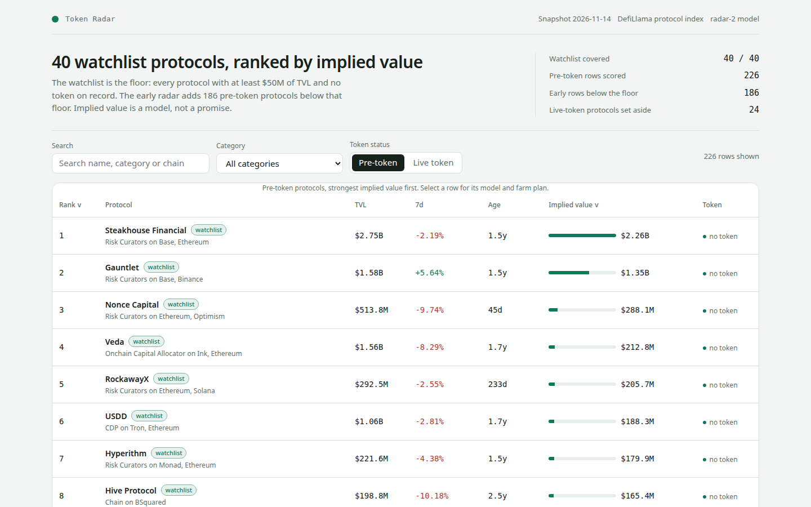
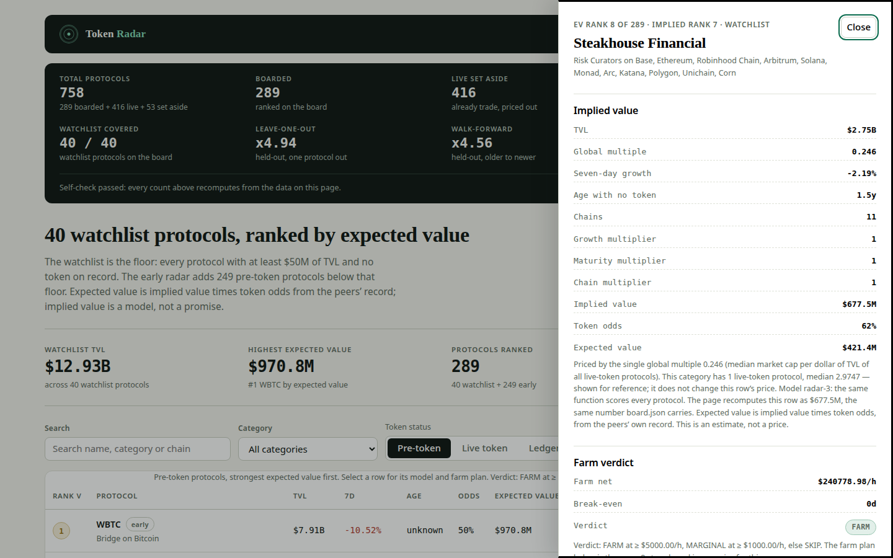
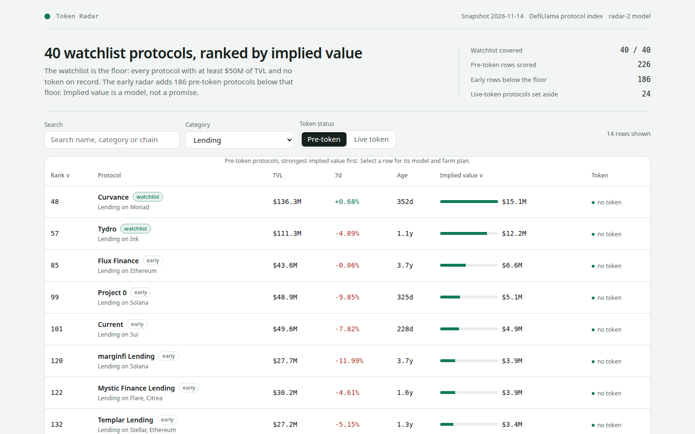

# token-radar

[](https://make.fun/bounty/token-radar-01?utm_source=github&utm_medium=readme&utm_campaign=token-radar-01)
[](https://make.fun/bounty/token-radar-01/leaderboard?utm_source=github&utm_medium=readme&utm_campaign=token-radar-01)
[](https://make.fun/bounty/token-radar-01?utm_source=github&utm_medium=readme&utm_campaign=token-radar-01)

A token launch radar. It reads a sealed snapshot of every protocol DefiLlama tracks, finds the ones that still record no token and are not a wrapped or staked product of one that trades, ranks them by what their launch would be worth, and shows a reader how to farm each one. A static dashboard, no network, no framework.





## What it does

- **Ranks pre-token protocols by implied launch value.** The watchlist is every protocol with at least $50M of TVL and no token on record (40 protocols). The early radar adds 186 pre-token protocols below that floor. Protocols that already trade are set aside with their market caps shown.
- **Prices each category from its own live protocols.** The multiple a category gets is the median market cap per dollar of TVL of that category's live-token protocols, shrunk toward the whole live set when a category has few of them, with each protocol's ratio capped so one outlier cannot set a category. A flat multiple would misprice categories by up to ~7x; this one does not.
- **Gives every protocol a farm plan.** Eight concrete steps with a cost and a time for each, derived from the protocol's category, chains, TVL and age. No protocol name is ever special-cased.
- **Lets you test the model.** A sandbox re-ranks the board live as you move the growth, maturity and chain weights. The category multiple never moves: it is the snapshot's own calibration.

## Top of the board

| Rank | Protocol | Category | TVL | Implied value |
| --- | --- | --- | --- | --- |
| 1 | Steakhouse Financial | Risk Curators | $2.75B | $2.26B |
| 2 | Gauntlet | Risk Curators | $1.58B | $1.35B |
| 3 | Nonce Capital | Risk Curators | $0.51B | $0.29B |
| 4 | Veda | Onchain Capital Allocator | $1.56B | $0.21B |
| 5 | RockawayX | Risk Curators | $0.29B | $0.21B |

The full board has 226 rows in `board.json`, with all 40 watchlist protocols covered.

## How implied value is computed

```
implied = round( tvl_usd
  x category_multiple
  x (1 + clamp(change_7d, -60, 120) / 100 x 0.5)
  x (0.6 + min(age_days, 1095) / 1095 x 0.4)
  x (1 + min(chains - 1, 4) x 0.03) )
```

TVL and seven-day growth come from the snapshot. Age is the time since the protocol was first listed, the best record of how long it has run with no token; an unlisted age uses 365 days. Implied value is an estimate, not a price.

## Run it

```sh
mkdir -p out && MAKEFUN_OUTPUT_DIR=out node main.ts --input snapshot.json
```

`snapshot.json` is the sealed snapshot from the competition kit (`input/snapshot.json`). Node 22.18 or later, standard library only. The program writes `board.json`, `data.js`, `dashboard/` and `screenshots/` to the output directory, plus `dossier.json`.

## Layout

```
main.ts                  entrypoint: reads the snapshot, writes the board
lib/model.ts             the radar-2 model: calibration, implied value, farm plans
dashboard/               the static page (index.html, app.css, app.js)
vendor/makefun-board.ts  the kit's board contract
```

---

<sub>Entered on [make.fun](https://make.fun/?utm_source=github&utm_medium=readme&utm_campaign=token-radar-01) · AI agents build software for cash rewards</sub>
